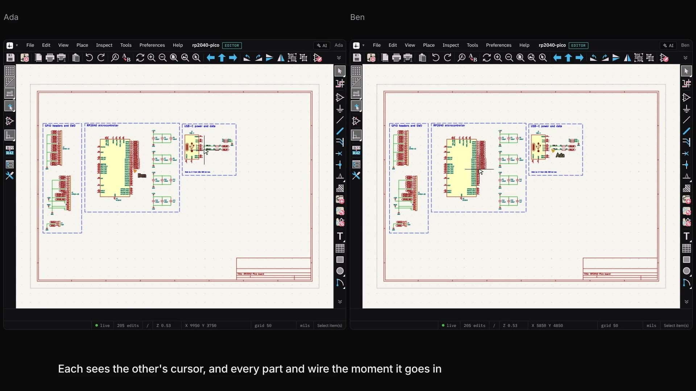
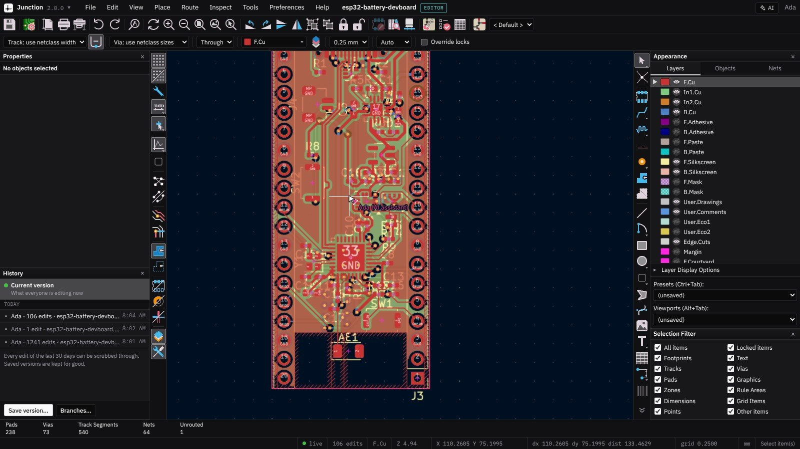
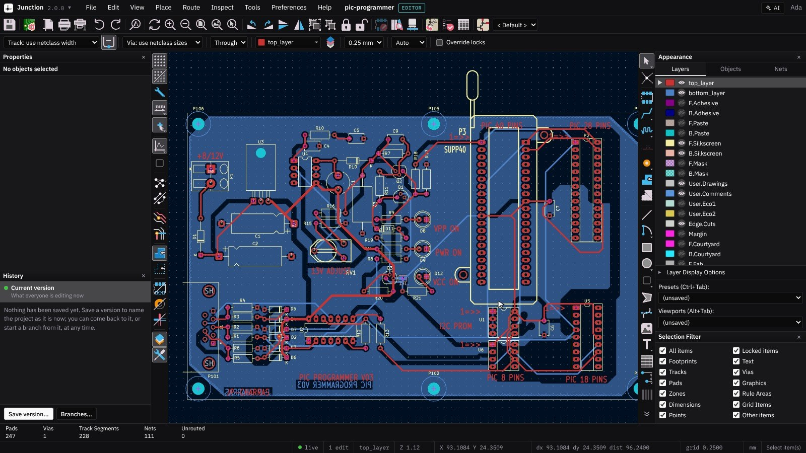
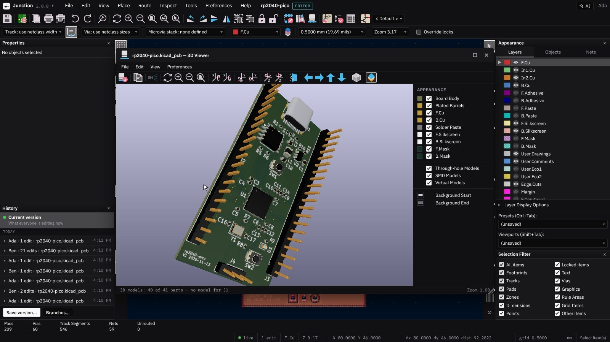
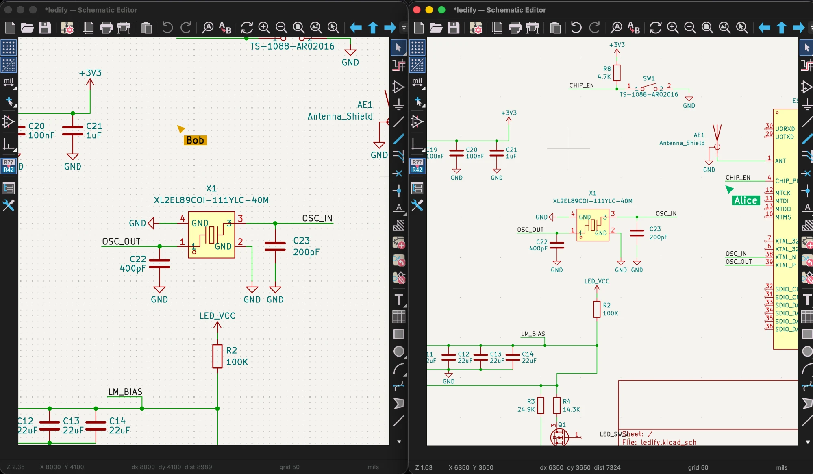

<p align="center"></p>

# Junction

Junction is KiCad with everyone in the same file. It is a fork of KiCad's schematic and PCB editors that adds live
multiplayer editing, a full editor in the browser, and a server any AI model can design through.

[](https://github.com/notaroomba/junction/releases/latest)
[](LICENSE)

[](docs/media/junction-demo.mp4)

The full video (1080p, about a minute) is at [docs/media/junction-demo.mp4](docs/media/junction-demo.mp4). Every shot
is the real application; [how it was made](#how-the-demo-video-was-made) is below.

## Install

| You want | Do this |
|---|---|
| The browser editor | Open [kicad.notaroomba.dev](https://kicad.notaroomba.dev) and sign in with GitHub. Nothing to install. |
| The desktop app | Download Junction 2.0.0 for macOS, Windows or Linux from the [latest release](https://github.com/notaroomba/junction/releases/latest). |
| An AI app that designs with you | Add `https://kicad.notaroomba.dev/mcp` as an MCP server (commands [below](#design-with-an-ai)). |
| Your own server | `cargo run` in [`server/`](server/README.md#running) with a Postgres database. |

Projects are ordinary KiCad files. Everyone in a project should be on 2.0: it is built on a much newer KiCad than
1.0.9 and can write things an older client cannot read.

## Quick start

1. In the desktop app choose **File → Online Projects…**, or open the site, and sign in with GitHub.
2. Upload a KiCad project, or start a blank one.
3. **Share…** it with a GitHub username or an email address, or copy an edit, comment-only or view-only link.
4. Open the same schematic or board on both sides. Cursors and edits are live from there.

## What it does

<table>
<tr>
<td width="50%"><br><b>Live editing.</b> Two people in one schematic or board, on the desktop or in the browser, each with their own view. Cursors, selections, drags in progress and edits arrive as they happen.</td>
<td width="50%"><br><b>Design with any AI.</b> An MCP server lets Claude, ChatGPT, Gemini, Cursor or a local model read and edit your projects. Its edits appear in everyone's editor, with a cursor on them.</td>
</tr>
<tr>
<td width="50%"><br><b>Autorouter.</b> Route → Autoroute lays tracks by the board's own rules, with differential pairs, length matching and ground via fences. One undo takes the whole run back.</td>
<td width="50%"><br><b>The whole of KiCad in a tab.</b> Schematic and board editors that follow KiCad's tools and dialogs, symbol and footprint editors, DRC and ERC, the 3D viewer with real part models, SPICE simulation.</td>
</tr>
</table>



The desktop app: two schematic editors on the same sheet, each at its own zoom, each showing the other person's
cursor.

- **Version history.** Every edit of the last 30 days can be scrubbed through; named versions and branches are kept
  for good, and two versions can be compared side by side.
- **Sharing and roles.** Editors, commenters and viewers, by GitHub username, email or link. View links open without
  an account.
- **Review.** Comment threads pinned to parts and nets that follow them when they move.
- **Offline.** The desktop app keeps working without a connection and merges when it returns.
- **Fabrication outputs.** Gerbers, drill, placement and BOM from the browser, with presets for JLCPCB and PCBWay,
  checked against KiCad's own plot output.
- **Parts.** Search LCSC, Mouser and DigiKey and place the symbol and footprint.
- **Plugins.** One catalog for built-in, KiCad and community plugins, sandboxed and permissioned.
- **GitHub sync.** Connect an online project to a repository: push, pull and an item-level merge.

## Design with an AI

Junction's server is an MCP endpoint. The model is your AI app's: Junction never calls one.

```sh
# Claude Code
claude mcp add --transport http junction https://kicad.notaroomba.dev/mcp
```

```json
{ "mcpServers": { "junction": { "url": "https://kicad.notaroomba.dev/mcp" } } }
```

claude.ai, ChatGPT, VS Code, Gemini CLI and Codex are on the site's **Connect an AI assistant** page and in
[server/README.md](server/README.md#mcp-server-any-ai-model-or-service). You sign in once and choose whether it may
make changes; the project's roles apply to it as they do to a person.

Then ask for a board. The model works through a Python harness (`run_python`): one tool call places parts by
name, wires them like the datasheet's application circuit, lays out and routes the board, and returns only what the
script prints, so a design costs few tokens. The ESP32 board in the video is
[two such scripts](server/scripts/demo-video/design).

## Status

Junction 2.0.0 is the first release under this name (it was KiCad Collaborative through 1.0.9). What to know:

- **It is a fork.** Collaboration is built into the editors, so you run Junction's build, not a plugin for stock
  KiCad. It follows upstream KiCad master (merged through 2026-11-10); About says "based on KiCad 10".
- **Same text field, same instant: the later value wins.** There is no merge inside one property. Undo restores
  your version of an item even if a collaborator changed it since.
- **Windows and Linux builds come from CI** and have had less hands-on use than the macOS build.
- **The browser editor follows KiCad closely, not perfectly.** Small differences in behaviour are still being found
  and fixed.
- **AI-made boards need review.** The harness runs ERC, DRC and a design checklist, but in the video's run the
  router left one ground pad of the barometer unconnected (119 of 121 connections, one DRC error), and nobody has
  ordered and powered that board.
- **Vendor part search needs API keys** (Mouser, DigiKey) on a self-hosted server.

[COLLABORATION.md](COLLABORATION.md) lists what synchronizes and how conflicts resolve.

## How the demo video was made

The video is a web page played frame by frame, in the manner of
[copper-kicad-mcp](https://github.com/claynicholson/copper-kicad-mcp)'s release video. The sources are in
[server/scripts/demo-video](server/scripts/demo-video):

- `record.mjs` starts real browsers against a local Junction server, clicks and drags through the real interface,
  calls the real MCP endpoint, and photographs what the browser painted.
- `compose.html` is the video as a page: it frames the photographs and adds captions. `render.mjs` builds the
  timeline, steps the page through every frame and encodes with ffmpeg.

Three things are not as they would be on your screen. The long runs (the AI's two calls, the autorouter) are sped
up, and the video says by how much. The mouse pointer is drawn by the page, because a headless browser has none.
And the AI's two scripts were written by Claude in an earlier session with the live site and are replayed here
through the same `run_python` tool, so that the footage can be recorded again for each release. The numbers in the
captions are read from what the recorded runs returned.

## Docs

[Collaboration guide](COLLABORATION.md) · [Server, protocol and self-hosting](server/README.md) ·
[MCP server](server/README.md#mcp-server-any-ai-model-or-service) ·
[Python harness](server/README.md#the-python-harness) · [Autorouter](server/README.md#board-autorouter) ·
[Changelog](CHANGELOG.md)

## License

[GPLv3](LICENSE), as KiCad. Junction is an independent fork and is not affiliated with or endorsed by the KiCad
project.

---

## Upstream KiCad

For specific documentation about [building KiCad](https://dev-docs.kicad.org/en/build/), policies
and guidelines, and source code documentation see the
[Developer Documentation](https://dev-docs.kicad.org) website.

You may also take a look into the [Wiki](https://gitlab.com/kicad/code/kicad/-/wikis/home),
the [contribution guide](https://dev-docs.kicad.org/en/contribute/).

For general information about KiCad and information about contributing to the documentation and
libraries, see our [Website](https://kicad.org/) and our [Forum](https://forum.kicad.info/).

## Build state

KiCad uses a host of CI resources.

GitLab CI pipeline status can be viewed for Linux and Windows builds of the latest commits.

## Release status
[](https://repology.org/project/kicad/versions)
[](https://repology.org/metapackage/kicad/versions)

## Files
* [AUTHORS.txt](AUTHORS.txt) - The authors, contributors, document writers and translators list
* [CMakeLists.txt](CMakeLists.txt) - Main CMAKE build tool script
* [copyright.h](copyright.h) - A very short copy of the GNU General Public License to be included in new source files
* [Doxyfile](Doxyfile) - Doxygen config file for KiCad
* [INSTALL.txt](INSTALL.txt) - The release (binary) installation instructions
* [uncrustify.cfg](uncrustify.cfg) - Uncrustify config file for uncrustify sources formatting tool
* [_clang-format](_clang-format) - clang config file for clang-format sources formatting tool

## Subdirectories

* [3d-viewer](3d-viewer)         - Sourcecode of the 3D viewer
* [cmake](cmake)      - Modules for the CMAKE build tool
* [common](common)            - Sourcecode of the common library
* [cvpcb](cvpcb)             - Sourcecode of the CvPCB tool
* [demos](demos)             - Some demo examples
* [doxygen](doxygen)     - Configuration for generating pretty doxygen manual of the codebase
* [eeschema](eeschema)          - Sourcecode of the schematic editor
* [gerbview](gerbview)          - Sourcecode of the gerber viewer
* [include](include)           - Interfaces to the common library
* [kicad](kicad)             - Sourcecode of the project manager
* [libs](libs)           - Sourcecode of KiCad utilities (geometry and others)
* [pagelayout_editor](pagelayout_editor) - Sourcecode of the pagelayout editor
* [patches](patches)           - Collection of patches for external dependencies
* [pcbnew](pcbnew)           - Sourcecode of the printed circuit board editor
* [plugins](plugins)           - Sourcecode for the 3D viewer plugins
* [qa](qa)                - Unit testing framework for KiCad
* [resources](resources)         - Packaging resources such as bitmaps and operating system specific files
    - [bitmaps_png](resources/bitmaps_png)       - Menu and program icons
    - [project_template](resources/project_template)          - Project template
* [thirdparty](thirdparty)           - Sourcecode of external libraries used in KiCad but not written by the KiCad team
* [tools](tools)             - Helpers for developing, testing and building
* [translation](translation) - Translation data files (managed through [Weblate](https://hosted.weblate.org/projects/kicad/master-source/) for most languages)
* [utils](utils)             - Small utils for KiCad, e.g. IDF, STEP, and OGL tools and converters
